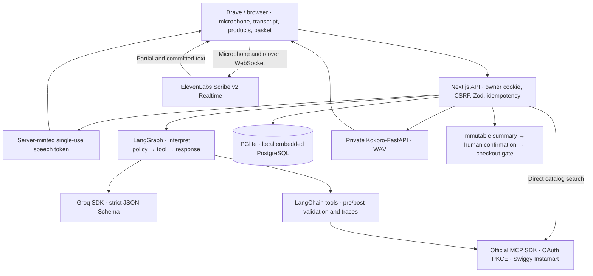

# SayCart · Voice ordering for Instamart

A local Next.js + TypeScript app for voice and text shopping across the catalog available through your Swiggy Instamart account, with the official MCP connector, Groq structured reasoning, and inline ElevenLabs live dictation.

**Current build:** live Swiggy account connection; direct category/product search with pagination; product cards with returned images, prices, packs and stock; live bag and complete provider bill; words transcribed directly into search and assistant fields; and explicit checkout review/confirmation. Demo mode is removed from the UI and API. Tests use isolated fixtures; they never submit real purchases. See [verification](docs/VERIFICATION.md) for actual MCP and speech checks.

## Run locally

Requires Node.js 22.12+ (verified with Node 24.16).

```bash
npm ci
npm run dev
```

You can also start with `bun run dev` after installing dependencies. Open **http://127.0.0.1:3000/** and choose **Connect Swiggy**. In development, opening `http://localhost:3000/` redirects to the configured loopback origin before sessions and Swiggy authorization begin. The server uses port 3000 explicitly; if it is occupied, stop the duplicate server before restarting. See the [development guide](docs/DEVELOPMENT.md) for a different port.

Select a saved delivery address, search products such as milk, skincare or headphones, choose an exact variant, and manage your live Instamart bag. Categories are search shortcuts; the app has no grocery-only allowlist. Availability, quantities and fulfillment depend on what the MCP returns for your address. Direct search does not use LLM tokens. Load more follows provider pagination, up to 500 saved results per search; narrow the query for more specific options.

Click a category to open its own free-text search beside the results. For example, choose **Snacks**, type **healthy**, and press **Enter** or **Search** to request **healthy snacks** from Instamart. Type any product, brand or preference; no preset filter is required. **Reset search** returns to the category's starting query, and **Search all Instamart** searches the typed words without category context. The top search bar always searches all Instamart. Each submitted search makes a provider request; typing alone does not call the service. Category context is a search phrase, not a strict provider category filter or a nutritional classification.

Refresh reads cart changes made in Swiggy. The complete provider bill, address and selected payment are shown before the explicit confirmation button can submit an order.

Copy [.env.example](.env.example) to `.env.local`, fill the server settings, and restart. `ELEVENLABS_API_KEY` enables inline live dictation; `GROQ_API_KEY` enables assistant reasoning; OAuth storage requires `TOKEN_ENCRYPTION_KEY`. All keys stay server-only. [Voice setup](docs/LOCAL_VOICE_SETUP.md) covers the live speech flow and optional Kokoro replies.

Tap the microphone beside the product search, category search or assistant field and speak: partial and final words appear directly in that field. Stop dictation, review/edit the text, then press Search or Send yourself. Discard restores the previous draft. Dictation is limited to 60 seconds and never submits a search, cart change or order automatically. Recognition can still mishear names, numbers or mixed-language speech.

```bash
npm run typecheck
npm test
npm run build
# With the dev server running; separate unconnected owner, no live cart/order changes:
node scripts/smoke.mjs
```

## Architecture



[Zod contracts](src/lib/contracts.ts) define requests, intents, products, carts, quotes and responses. Groq receives JSON Schema generated from the same intent schema. Server policy checks known products, quantities, ambiguity and permissions after parsing. The model has no checkout tool.

The pilot stores browser-scoped sessions, encrypted OAuth state, traces, idempotency records, immutable quotes and purchase attempts in local PGlite. Run **one Node process** with a private persistent data directory. Production authentication, shared PostgreSQL deployment, retention/rotation and live payment reconciliation are still required before hosting for customers.

## Included

- Responsive shopping interface with category shortcuts, direct search, pagination, sorting/stock filters, product cards, a live bag, and address/payment review.
- Inline dictation through the official ElevenLabs browser SDK: one microphone session, visible listening/finishing states, editable text, discard and explicit submission. The server mints single-use tokens without exposing the account key. ElevenLabs is the only transcription provider; unused batch transcription and ffmpeg code have been removed. Kokoro spoken replies require a separate service.
- Groq `openai/gpt-oss-20b` structured intent, bounded context, provider token metrics and recoverable errors.
- LangGraph orchestration and LangChain tools with pre/post hooks, durable traces and cancellation/version checks.
- Two-minute live checkout summaries, explicit UI confirmation, fresh snapshot revalidation, owner isolation and a durable attempt recorded before dispatch. Payment completion is not used as an automated test.
- Official MCP SDK OAuth with PKCE, encrypted per-browser credentials, discovered input validation, real product/cart mappings and validated payment/order responses. Every cart edit compares a fresh provider fingerprint and preserves unrelated items. Unknown checkout outcomes retain a durable gate and are never automatically retried.

## References and docs

[Implementation references](docs/IMPLEMENTATION_REFERENCES.md) connect our modules to reviewed repositories, with commit pins where available. [Source reviews](docs/REFERENCE_ARCHITECTURES.md) include actual Swiggy voice/MCP applications and local speech/Groq projects, with adopted patterns, known gaps and license boundaries. We use their architectures as references; we do not claim they implement this exact stack or copy unlicensed application code.

Read the [development guide](docs/DEVELOPMENT.md), [implemented API](docs/API_CONTRACT.md), [architecture](docs/ARCHITECTURE.md), [Swiggy integration status](docs/SWIGGY_MCP.md), and [documentation index](docs/README.md). The remaining roadmap and detailed production contracts are design targets, not shipped features.

SDK, MCP and LangGraph have separate responsibilities. We use one workflow runtime; adding Google ADK alongside it would duplicate orchestration. Shell, glob, grep, read and write are development tools, not capabilities given to the shopping model.

This project is not affiliated with Swiggy. A repository license has not yet been selected.
