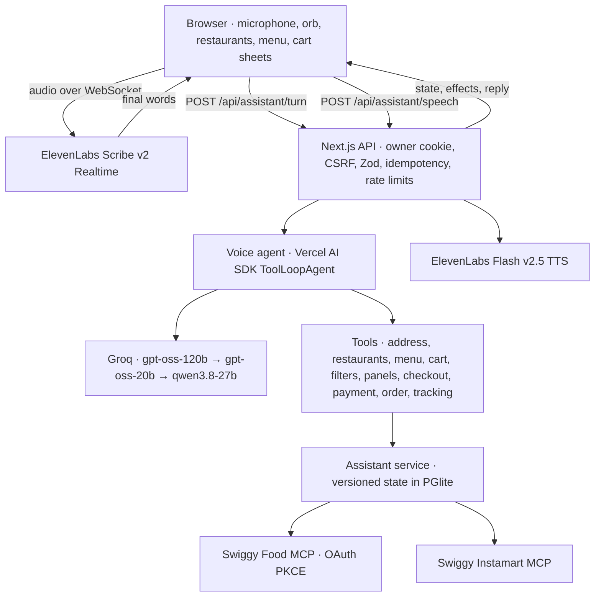

# SayCart · Order food by talking

A local Next.js + TypeScript voice assistant for Swiggy. Open it and speak in English, Hinglish or Hindi (listening starts on its own; **Stop listening** pauses it): choose the delivery address, find and open restaurants, add dishes, check out, pay and track the order, all by voice. The screen shows restaurants, menus and the cart; replies are spoken.

**Current build:** a voice-first home screen (one small orb, no transcript or text box); an AI agent built on the Vercel AI SDK with Groq models that acts through tools on a numbered snapshot of the screen; Swiggy Food addresses, restaurants, menus with prices, cart sync, live bill, payment, order placement and live tracking with “order again”; a Swiggy-style food front (“What's on your mind?” cuisines, quick filters, top rated) and an Instamart home with aisles and product rails, both built on the same Swiggy MCP searches; Instamart groceries by voice, from search to a placed order; voice on by default with a spoken greeting and a connect prompt when Swiggy is not linked; an Undo toast for every change the assistant makes; contextual “try saying” hints; and taps on cards, steppers and sheets as an alternative to speaking.

**Provider boundaries:** Swiggy Food ordering is implemented against the Swiggy Food MCP tools but has been exercised end to end only with the synthetic development fixture; no real order or payment was made while building it. Food menu prices come from Swiggy in whole rupees (checked against live menus on 25 October 2026). Zomato is shown as requiring app access. Speech uses ElevenLabs with a server-side secret key. See [the voice assistant](docs/ASSISTANT.md) and [verification](docs/VERIFICATION.md).

## Run locally

Requires Node.js 22.12+ (verified with Node 24.16).

```bash
npm ci
npm run dev
```

Open **http://127.0.0.1:3000/** and allow the microphone. Listening starts on its own and the assistant greets you: it asks you to connect Swiggy when no account is linked, otherwise which saved address to use. Browsers only play sound after a first click or key press, so click anywhere once if the greeting is silent. **Stop listening** (or Escape) pauses; **Resume** continues. Open **Connections** to sign in to Swiggy Food (and Instamart for groceries). In development, `http://localhost:3000/` redirects to the configured loopback origin before sessions and Swiggy authorization begin. See the [development guide](docs/DEVELOPMENT.md) for a different port.

Copy [.env.example](.env.example) to `.env.local`, fill the server settings, and restart. `GROQ_API_KEY` runs the voice agent; `ELEVENLABS_API_KEY` enables realtime speech recognition and spoken replies (speech-to-text and text-to-speech permissions); OAuth storage requires `TOKEN_ENCRYPTION_KEY`. All keys stay server-only. [Voice setup](docs/LOCAL_VOICE_SETUP.md) covers permissions, languages and testing without a microphone.

Groq's free tier limits each model per minute and per day, which a few dozen spoken turns can use up; the agent then falls back to smaller models and, when all are busy, says so. A paid Groq tier removes those waits ([details](docs/ASSISTANT.md#speed-and-resilience)).

To try everything without a Swiggy account or real orders, run the development stores (restaurants and Instamart) with a scripted microphone:

```bash
SAYCART_FIXTURE=1 SAYCART_DIST_DIR=.next-fixture DATA_DIR=memory:// APP_ORIGIN=http://127.0.0.1:3001 npx next dev --hostname 127.0.0.1 --port 3001
```

Then open `http://127.0.0.1:3001/?fakeMic=1` (listening starts on its own) and run `await saycartVoice.say("ghar pe deliver karo")` in the browser console.

## Checks

```bash
npm run check          # typecheck, unit/integration tests (including scripted agent tests), production build
npm run evals:agent    # live Groq conversations against the fixture; no real orders
npm run test:http      # with the app running: HTTP boundary checks, no model, speech or merchant calls
```

The [eval guide](docs/EVALS.md) explains the scripted agent tests and the live agent scenarios.

## Architecture



Each turn the agent sees a numbered snapshot of the screen (address, restaurant list or menu, cart, checkout, order) and acts with tools; the server re-resolves every name against what Swiggy returned, so the model cannot invent a dish, address or order. Placing an order requires a reviewed total that the customer heard in an earlier reply and their own confirming words, checked in code ([consent rules](docs/ASSISTANT.md#ordering-and-consent)).

The pilot stores browser-scoped sessions, encrypted OAuth state, idempotency records, quotes and order attempts in local PGlite. Run **one Node process** with a private persistent data directory. Production authentication, a shared PostgreSQL deployment, retention and live payment reconciliation are still required before hosting for customers.

## References and docs

[Implementation references](docs/IMPLEMENTATION_REFERENCES.md) connect our modules to reviewed repositories, with commit pins where available. [Source reviews](docs/REFERENCE_ARCHITECTURES.md) include actual Swiggy voice/MCP applications and local speech/Groq projects, with adopted patterns, known gaps and license boundaries. We use their architectures as references; we do not claim they implement this exact stack or copy unlicensed application code.

Read the [development guide](docs/DEVELOPMENT.md), [implemented API](docs/API_CONTRACT.md), [architecture](docs/ARCHITECTURE.md), [Swiggy integration status](docs/SWIGGY_MCP.md), and [documentation index](docs/README.md). The remaining roadmap and detailed production contracts are design targets, not shipped features.

The Vercel AI SDK runs the agent loop and the MCP SDK talks to Swiggy; there is one orchestration runtime. Shell, file and search tools are development tools, not capabilities given to the shopping model.

This project is not affiliated with Swiggy. A repository license has not yet been selected.
