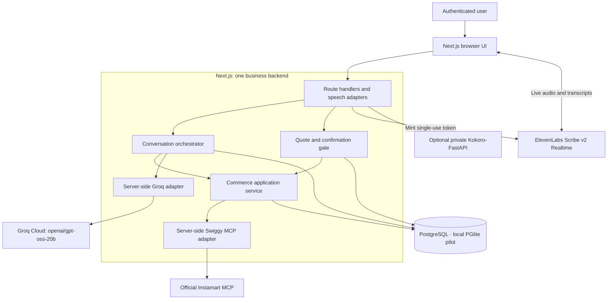

# Architecture

## Implemented local pilot · 21 October 2026

The runnable build is summarized in the [root diagram](../README.md#architecture). The app is live-only: direct catalog search and category shortcuts call Swiggy MCP without LLM tokens, retain provider pagination privately, and show up to 500 returned variants per query. Images, packs, prices, stock and quantity limits come from provider data. Categories are search shortcuts, not a claim of complete catalog coverage.

`src/lib/contracts.ts` owns Zod request/response contracts and the JSON Schema sent to Groq. `src/server/agent.ts` uses one LangGraph workflow for intent, policy, bounded LangChain tools and deterministic outcomes. Pre/post hooks record timing/status traces; token metrics come from Groq. Natural-language product requests search first; exact variants and valid quantities are required for cart changes.

Assistant requests include up to 20 displayed product IDs in screen order. The server validates them against the current session catalog and resolves trusted product data before interpreting positional references. Price sorting and availability filters therefore affect “the first one” consistently, while the full catalog and pagination remain unchanged.

`src/server/shopping.ts` owns versioned live sessions, fresh cart fingerprints, full provider bills, address/payment selection, immutable two-minute quotes, explicit UI confirmation and durable attempts/gates. `src/server/service.ts` exports the configured live service. `src/server/store.ts` uses PGlite transactions in one Node process. Browser-owner cookies isolate this local pilot; production sign-in and shared deployment remain future work.

Production owner queues and cancellation controllers survive module reloads in a process-scoped runtime. Session creation rechecks the owner's session transactionally. Session refresh waits for queued work before clearing an orphaned activity marker from an interrupted request; it refreshes the cart without replaying the operation or releasing a checkout gate. These changes were source-reviewed only; see [CODE_REVIEW.md](CODE_REVIEW.md).

`src/server/integrations/swiggy.ts` uses the official MCP SDK for owner-scoped OAuth PKCE, discovery, validated arguments and mapped structured responses. Cart edits preserve unrelated items and respect fresh provider state. A pending or unknown checkout retains its gate; payment polling and automated reconciliation are not implemented. The UI directs the user to check Swiggy and distinguishes refreshing saved status from a provider status check.

`src/lib/use-inline-dictation.ts` lazily loads the official ElevenLabs client SDK and streams microphone audio directly to `scribe_v2_realtime`. An owner/CSRF-protected route validates the session and mints a single-use token with the server-only key. Partial and committed words update the originating product-search, category-search or assistant field. Stop manually commits with a bounded final wait; discard restores the prior draft. Captures stop at 60 seconds and never auto-submit. The SDK audio worklet is served from the same origin with its MIT notice.

`src/server/voice.ts` mints ElevenLabs tokens and supplies optional Kokoro synthesis. Unused batch transcription and local audio decoding were removed. Submitted assistant text/context goes to Groq for intent; live microphone audio goes to ElevenLabs. Token creation, account permissions, microphone behavior and recognition quality remain unvalidated after the skip-testing request.

Only the explicit checkout button consumes a quote challenge. The model has no checkout tool. Dedicated voice confirmation, persistent LangGraph checkpoint resume, continuous conversation and automatic payment reconciliation remain future work. [Verification](VERIFICATION.md) records earlier checks and the latest stop-testing request; final edits are not claimed fully verified.

## Broader release design

The following sections retain production targets and proposed refinements. The implementation description above takes precedence. In particular, production authentication, provider-account coordination, voice confirmation and payment reconciliation below are requirements, not shipped capabilities.

## System boundary

The application turns a user's spoken shopping request into an editable Instamart cart, presents a live checkout summary, and submits checkout only after explicit confirmation. The official Swiggy Instamart MCP server is the primary commerce integration. Test doubles support automated tests; they are not the default product backend.

The language model produces typed intent candidates and optional dialogue fields through a nonstreaming Groq request with a strict JSON Schema response format. The selected model is `openai/gpt-oss-20b`. Do not attach tools or MCP to that request: Groq's structured-output mode does not support combining structured output with tool use. See [OPEN_SOURCE_STACK.md](OPEN_SOURCE_STACK.md) for the verified provider constraints.

Schema compliance is only the first check. Next.js validates semantic correctness, user/session ownership, current product references, allowed actions, quantities, and required clarification before executing anything. The application owns authorization, tool selection, cart changes, and checkout decisions; the model receives no MCP executor, provider tokens, or Groq credentials.

For a request that needs live catalog context, the server can run a bounded orchestration loop: request intent, validate it, execute an allowed MCP read or authorized cart operation, then supply a minimal normalized result to a fresh structured-intent request when necessary. Enforce ceilings for total elapsed time, model requests, output size, and commerce actions. Invalid or ambiguous output leads to clarification or a recoverable error, never an unrestricted model/tool loop.

The final review summary is rendered deterministically from the immutable live quote, including its full bill, selected address, and payment method. Model-generated prose cannot replace, amend, or confirm that summary. TTS speaks only server-approved text.

## Process layout

| Process | Selected responsibility |
| --- | --- |
| Next.js / TypeScript | The single business backend and browser UI; server orchestration, ownership, OAuth, MCP, quote/checkout policy |
| ElevenLabs SDK / Scribe v2 Realtime | Browser dictation using a server-minted single-use token; partial text goes directly into the selected field |
| Kokoro-FastAPI service | Existing self-hosted Kokoro-82M inference server; initial English voice `af_heart`; our `services/kokoro/` holds deployment/configuration |
| Server-side Groq adapter | Hosted `openai/gpt-oss-20b` reasoning through Groq's OpenAI-compatible API; strict structured shopping intent |
| PostgreSQL persistence | Durable session, quote, confirmation, attempt, and reconciliation state |

Optional Kokoro output runs as a private sidecar. Inline speech streams from the browser to ElevenLabs after server token creation. In local development, bind them to loopback and let only server adapters call them; browsers use the application API. Reasoning runs on Groq Cloud at `https://api.groq.com/openai/v1`, using a server-only API key. This is a hybrid deployment with open-source models served by hosted APIs and optional private speech services; it is not fully self-hosted. Groq and the official Swiggy MCP connection require network access.

Target Groq's free plan for the MVP within its current organization-shared limits. The free allowance is not a permanent cost or capacity guarantee. Honor rate-limit responses and `Retry-After` with bounded retries; preserve the user's session and show a recoverable error if the budget is exhausted. Do not silently upgrade to paid usage, change models, or fall back to another provider.

Keep click-to-start inline dictation and explicit text submission for the initial flow. Pipecat and LiveKit are outside this baseline; reconsider a realtime transport/orchestration layer only if streaming, interruption, or calls become accepted requirements.

The [reference architecture review](REFERENCE_ARCHITECTURES.md) traces these boundaries to actual Swiggy and voice-agent code. Reuse the existing Kokoro service behind an adapter, with reviewed configuration and a tested version. Runtime/model defaults remain subject to matched shopping-audio and spoken-response evaluation; the local `small` setup is an evaluation baseline, not the hosted default.

## Audio and turn lifecycle

For inline dictation, the SDK handles microphone capture and audio streaming; one field owns the active connection and stale events are discarded. Audio capture is bounded to 60 seconds; stop commits the last words and cancellation releases the connection. The app no longer accepts uploaded audio for batch transcription.

Load speech models once, warm them before readiness, and reuse them across turns. Bound worker concurrency and queue size. Use a session turn version and turn IDs to associate transcription, Groq results, speech, and UI updates. Check the current version before starting a new inferred commerce action; ignore stale completions for playback.

Stopping playback is immediate in the client. A processing stop marks the turn superseded and cancels pending speech/model work where possible; it cannot undo a dispatched provider mutation. Reconcile dispatched actions and present their authoritative result even if the original turn is superseded. Do not let an old turn replace the current cart view or initiate another purchase.

Generate speech from complete approved sentences or the deterministic quote summary. Audio streaming is a separate capability from Groq text streaming; strict structured-intent requests remain nonstreaming. Confirm the actual first-playable-audio behavior in tests instead of assuming a streaming API name means concurrent end-to-end playback.

## Proposed code boundaries

| Location | Responsibility |
| --- | --- |
| `app/` | Next.js pages and same-origin API route handlers |
| `components/` | Microphone controls, transcript, product choices, cart, checkout summary |
| `src/server/voice/` | Provider-neutral transcription and speech synthesis adapters |
| `src/server/conversation/` | Session context, validated intent, clarification, confirmation turns |
| `src/server/commerce/` | Cart operations, live quotes, checkout gate, reconciliation |
| `src/server/integrations/groq/` | Server-only API client, strict intent schema, response validation, rate-limit handling |
| `src/server/integrations/swiggy/` | MCP transport, authenticated calls, capability/schema mapping |
| `src/server/persistence/` | Persistence, transactions, local deduplication, audit events |
| `services/kokoro/` | Version/deployment/private configuration for upstream Kokoro-FastAPI; no commerce logic |
| `prisma/` | Schema and migrations, once implementation starts |
| `tests/{unit,integration,e2e,fixtures}/` | Domain tests, MCP contract fixtures, user journeys |

Keep business logic in a single TypeScript Next.js application with route handlers. The separate local processes implement narrow speech interfaces; the hosted model uses its own server adapter. Keep all provider payloads behind adapters so service or model changes do not rewrite the commerce domain.

## Request lifecycle

1. Authenticate the app user, establish an app session, and connect that user's Swiggy account through the server-side OAuth flow. Fetch saved addresses and select one before address-dependent catalog discovery.
2. Capture audio only after a user action. Mint a single-use token on the server, stream browser audio to ElevenLabs, and render partial/final words directly into the originating field. Stop and edit before explicitly submitting a search or assistant request.
3. Send the transcript or corrected text and minimal relevant context to Groq through the server adapter. Request a nonstreaming strict JSON-schema intent, validate its structure and meaning in Next.js, and use bounded server orchestration for any necessary live discovery. Resolve ambiguous product, unit, brand, or quantity choices before changing the cart.
4. Fetch live provider data. Apply an authorized cart change through the commerce service, preserving items outside the requested change.
5. Select an available provider-supplied payment method for the current address/cart. Fetch the current cart and checkout data to create a short-lived immutable quote. An address change refreshes address-dependent products/cart data and invalidates earlier quotes.
6. Present the deterministic complete quote summary; use local Kokoro for speech output when requested. Accept a dedicated explicit voice/text confirmation turn or a labeled UI action bound to that quote.
7. Revalidate the quote and live checkout inputs, persist a checkout attempt, and dispatch initial checkout once for that local attempt. Any required payment finalization is a separately recorded, deduplicated phase using the same purchase references.
8. Persist and present each returned order/payment result. Reconcile pending or uncertain outcomes before allowing another checkout.

## Cart consistency

The provider's cart may also change outside this app. `update_cart` replaces the whole cart; the adapter must fetch a baseline, apply only the requested edit, preserve other items, and compare against a fresh cart before writing when possible. Return a conflict and refresh if the baseline changed.

Serialize this app's cart/checkout operations using a durable user/provider gate and use an app cart revision for stale UI requests. Preserve the gate across reconnects. For multi-user ordering, require a verified stable provider-account identity and account-scoped coordination so two app users cannot independently write the same remote cart. Until that identity is verified, live purchasing is limited to a controlled single-user pilot. These controls do not lock the provider account against other clients: an external edit can race the final comparison. Do not claim provider-side atomicity. After a timeout, fetch and reconcile the live cart before retrying a replacement.

## Quote and checkout invariants

- A quote is immutable and bound to its app user, session, provider connection, exact provider cart fingerprint, selected address, selected live payment method, total, and currency.
- The proposed quote lifetime is 120 seconds, configurable. Expiry, any relevant input change, or a changed provider total requires a fresh quote and fresh confirmation.
- The server issues a confirmation challenge with the current summary. A confirmation event records an explicit user action after that summary; model output, inferred intent, and background audio cannot create that event. Confirmation audio must be newly captured after that summary, bound to its quote/challenge on upload, and consumed once.
- Immediately before checkout, compare live cart/address/payment/total with the quote. A mismatch stops submission. This comparison reduces races; it cannot guarantee an atomic provider transaction.
- Atomically claim the durable checkout gate, consume confirmation, and persist a local attempt and deduplication key before the provider call. The gate covers prepared and unresolved attempts across app instances and credential reconnects. Local idempotency prevents this app from repeating the same operation; it is not a provider idempotency guarantee.
- A timeout or interrupted response means an unknown outcome, not a failed order. Block further checkout for that unresolved attempt and reconcile through provider status capabilities; escalate to manual review if those cannot establish the result.
- A checkout may return multiple store/order results. Preserve all of them and represent partial success and payment pending separately from complete success.
- Quote expiry gates initial dispatch. For a known pending-payment attempt, follow live status and complete the same paid order only when required, using its stored references and original authority. Keep status GETs read-only; payment confirmation uses a validated POST or explicitly configured worker, never another checkout.

## Authentication and trust

Every resource lookup is scoped to the authenticated app user. Each user has their own Swiggy OAuth 2.1/PKCE connection; tokens stay encrypted on the server and are excluded from browser responses, model context, and logs. App sign-in and provider authorization are separate concerns.

Validate OAuth state and callback binding; use secure session cookies, same-origin checks, and CSRF protection for cookie-authenticated mutations. Validate request bodies and MCP responses against typed schemas. Treat transcripts, model output, and provider text as untrusted data; none can override the checkout gate or tool allowlist. Keep the Groq key server-only. For intent, send Groq only the minimum transcript, conversation and normalized product/cart context; exclude full addresses, payment secrets and OAuth tokens. Inline dictation separately sends live audio to ElevenLabs with a single-use token; the account key remains server-only. Disclose these distinct boundaries.

Discover supported MCP tools and schemas and map only the capabilities documented in [SWIGGY_MCP.md](SWIGGY_MCP.md). Fail visibly when a required capability is absent. Avoid guessed tool arguments or silent substitution of mock commerce data.

## Operations

Attach request, session, quote, and attempt IDs to structured events. Record tool names, latency, normalized outcomes, and redacted error codes; omit tokens, raw audio, full addresses, and payment secrets. Keep provider raw statuses separately from application states.

Use bounded retries for safe reads. Resolve mutation outcomes before retrying. Keep long-running checkout state in the database so a browser refresh or route timeout cannot lose an attempt. Raw audio and transcript retention must follow the policy established before implementation; avoid indefinite retention by default.

See [DATA_MODEL.md](DATA_MODEL.md) for persistence and [API_CONTRACT.md](API_CONTRACT.md) for proposed app routes.
