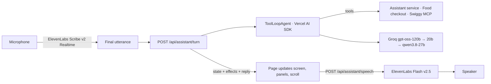

# Voice assistant

Updated 25 October 2026. SayCart is voice-first: open `http://127.0.0.1:3000/` and listening starts on its own; **Stop listening**, Escape or Space pauses it and **Resume** continues. On a new visit the assistant speaks first: it asks the customer to connect Swiggy when no account is linked (and the page shows a **Connect Swiggy** card), asks which saved address to use when none is chosen, and otherwise asks what to order. Browsers play sound only after a first click or key press, so the first tap anywhere also unlocks speech. There is no typed conversation, transcript panel or Party tab. Taps on cards, steppers and sheets still work, and they use the same server actions as the voice agent.

## What a customer can say

| Say | What happens |
| --- | --- |
| “I want to order food” / “मुझे खाना ऑर्डर करना है” | Asks Home or Work (the saved Swiggy addresses), then lists nearby restaurants |
| “ghar pe deliver karo”, “deliver to work” | Chooses that saved address |
| “biryani wale restaurants dikhao” | Searches Swiggy for restaurants serving it |
| “Meghana kholo”, “open the second one”, “isko kholo” | Opens a menu by name, list number or the highlighted card, also from inside another menu |
| “do chicken biryani aur ek paneer biryani daal do” | Adds both dishes; Hindi numbers count (do = 2) |
| “just one”, “remove the pizza” | Sets an exact quantity or removes a dish, also after leaving the menu |
| “top rated pehle”, “sirf open wale”, “filter hata do” | Sorts or filters what is on screen; when nothing matches, the agent searches Swiggy instead of blanking the screen |
| “neeche scroll karo”, “ruko” | Scrolls continuously, stops (handled in the browser, without a server turn) |
| “cart dikhao”, “close that” | Opens or closes a panel |
| “checkout karo” | Syncs the cart to Swiggy, shows the live bill and asks how to pay |
| “cash on delivery”, “PhonePe se” | Chooses the payment and reads out the exact total |
| “haan” / “confirm order” | Places that reviewed order (see consent below) |
| “mera order kahan tak pahuncha?” | Reads Swiggy's live tracking (an Instamart order reports its confirmation; track it in the Swiggy app) |
| “pichla order dobara”, “order it again” | Opens the previous order's restaurant and adds the same dishes |
| “Instamart kholo”, “groceries dikhao” | Opens the Instamart home: aisles and product rails |
| “chips aur do coca cola daal do” | Searches Instamart and adds each product as its own cart line |
| “checkout karo” with dishes and groceries | Asks which order goes first: restaurant or Instamart |
| “haan, replace kar do” | Empties dishes already sitting in the Swiggy app cart, only after you agree |
| “sab clear karo” | Starts a fresh order |
| “bye”, “that's all”, “band karo” | Stops listening |

Replies are spoken, at most two short sentences, in the script of the customer's latest words: Devanagari Hindi, Hinglish in Roman letters, or English. When the model answers in the wrong language, a fast second model (Qwen, no reasoning) rewrites just that reply; if the rewrite fails, the original stands.

## On screen

- **Undo for every voice change.** When the assistant adds, changes or removes something, a toast says what (“Added 2× Peri Peri Fries”) with **Undo**; the dish is also highlighted and scrolled to the middle of the screen.
- **“Try saying” hints.** A few chips above the orb suggest the next useful sentence for the current screen (an address, “Open Meghana Foods”, “Add two Paneer Biryani”, “Checkout”, “Confirm order”). Tapping one says it. They fade after a few seconds.
- **Live order tracking.** After an order, the header shows a status chip (“On the way · 12 min”), the page shows a banner, and the order sheet shows a timeline (confirmed → preparing → on the way → delivered) with the ETA, the dishes, the total and the payment. It refreshes on its own. Once delivered, **Order again** repeats the order by voice.
- **The Swiggy app shows the same cart.** Dishes and groceries go into the Swiggy app as they are added, changed or removed, by tap or by voice: dishes into the Swiggy Food cart, groceries into the Instamart bag. The cart marks them “in your Swiggy cart” and “in your Instamart bag”, and quantities stay editable through checkout. Each grocery change moves only SayCart's own share of a pack, so packs the customer added in the Swiggy app stay; removing every dish empties the Swiggy Food cart only while it still holds what SayCart put there. A Swiggy Food cart holding dishes the customer added in the Swiggy app is never replaced without asking: the cart shows **Replace with these dishes**. Starting a fresh plan leaves both Swiggy carts as they are.
- **Errors where you are looking.** A failed checkout or payment shows its reason inside the open sheet. A Swiggy app cart that already holds other dishes is shown as a question with **Replace and continue** or **Keep it**.
- **Swiggy-style fronts.** Food delivery opens on “What's on your mind?” cuisine tiles, a “Top rated near you” rail, quick filters (Sort, Fast delivery, Ratings 4.0+, Open now) and the restaurant list. The Instamart tab opens a home with 14 aisles (Fruits & Vegetables, Dairy & Milk, Munchies, Personal Care…) and rails (Daily essentials, Munchies, Cold drinks, Sweet cravings); an aisle opens its products with an aisle bar to hop between them. The Swiggy MCP has no category or recommendation tool, so every tile and rail is one product search ([`grocery-catalog.ts`](../src/lib/grocery-catalog.ts)) and every product shown is one Swiggy returned. A product already in the cart shows its stepper wherever it appears again, and choosing it from another aisle keeps one cart line. Instamart lists every pack size as its own product, so a rail shows each product once (the size in the cart, else the cheapest) with “N sizes”; the aisle keeps every size as its own numbered card. Instamart is a separate Swiggy connection: its screens show a **Connect Instamart** card, the home reloads by itself after connecting, and without Swiggy Food the address picker and header use Instamart's own saved addresses.
- **Taps act at once.** Addresses, cuisine tiles, aisles, rails and the tabs call the app directly instead of going through the assistant.
- **Space** starts or pauses listening on a keyboard.

## How it works



[`src/server/voice-agent.ts`](../src/server/voice-agent.ts) runs one turn:

1. **Screen snapshot.** The model sees what the customer sees: the delivery address and saved addresses, the numbered restaurant list or menu (with `[in cart ×n]` and the highlighted card), the cart, an open checkout or reviewed total that matches the current cart, and any order in progress. Numbers in the snapshot are the numbers on screen, so “the second one” means the same thing to both.
2. **Tools.** `set_delivery_address`, `find_restaurants`, `open_restaurant`, `back_to_restaurants`, `show_more`, `update_cart`, `view_controls`, `scroll`, `show_panel`, `checkout`, `choose_payment`, `place_order`, `order_status`, `find_groceries`, `open_instamart`, `start_over` and `stop_listening`. Every tool is always offered (Groq rejects a call to a tool that was left out); each one refuses what does not apply yet, such as `place_order` without a reviewed total. Tools that change the list return the fresh snapshot; failures and refusals come back as plain words the agent can explain.
3. **Effects.** Panels, scrolling, filters and “stop listening” are returned as effects; the page applies them after showing the new state.
4. **Reply.** `tidy()` strips markdown, emoji, list numbering and runaway punctuation, and keeps at most three sentences. The turn is saved with a separate `speech` rendering (“₹1,117” → “1117 rupees”) for text-to-speech.

The model resolves names; the server resolves them again against what was actually returned (`matchSpoken`, `resolveAddressAnswer`), so an invented dish, restaurant or address never becomes a selection. A grocery named but not on screen is looked up on Instamart inside `update_cart`, so “do coca cola aur ek Lay's” works in one step. The number spoken right before a name (“do coca cola”, “दो Chicken Biryani”, “three fries”) is used when the model defaulted to one. Adding by a list number is accepted when the customer spoke a position (“the first one”, “number 2”, “teesra”) or named that item (also in Devanagari, compared after romanizing); otherwise the model is told which item that number is. Two additions of the same product in one request are flagged as a misreading. When no address is set and the customer names one (“ghar pe deliver karo”, “घर पर”, “Work”), it is chosen before the model runs.

### Ordering and consent

Placing an order is real money, so consent is checked in code, never left to the model. The same rules apply to restaurant and Instamart orders:

- `place_order` needs a live reviewed total (two-minute quote) for exactly the current cart.
- The customer must have **heard** that total in an earlier reply. “Pay with PhonePe and place the order” in one breath reviews the total and asks; it does not order.
- “confirm order”, “place the order” or “order kar do” then places it. A bare “haan”/“yes” counts only when the previous reply stated that total; a yes to some other question never places an order.
- Tapping **Place order** (restaurant) or **Confirm & order** (Instamart) on the reviewed total is the other way to consent.
- Dishes already in the customer's Swiggy app cart are replaced only when their own words agree (“haan, replace”), never on the model's say-so.
- Restaurant dishes and Instamart groceries are separate orders; when the cart has both, the assistant asks which to check out first.
- **UPI is paid from SayCart's screen, not approved elsewhere.** Swiggy creates a UPI order as `PENDING_PAYMENT` and sends no request to the phone or the Swiggy app. The order sheet shows “Pay to place your order”: on a computer a QR of Swiggy's `upi://` link to scan with PhonePe, Google Pay or any UPI app (the computer is offered **Scan UPI QR**, and “PhonePe se” chooses it); on a phone an **Open UPI app** button; **Open payment page** whenever Swiggy sends its payment page; and the time left. Status checks run one at a time until the payment succeeds (then `confirm_order` if Swiggy has not confirmed it) or ends; if the time runs out, SayCart calls `confirm_order` once, as Swiggy asks, and the order ends as not placed. The agent cannot call an unpaid order placed or promise a phone request. A completed order empties the restaurant cart.
- `stop_listening` only works when the customer's own words say goodbye; the model cannot hang up on them.
- `set_delivery_address` only works when the customer's own words name the address (“ghar”, “Work”, “घर पर”); the model cannot choose where to deliver.

Food menu prices arrive from Swiggy in whole rupees (checked against live menus on 25 October 2026; `SWIGGY_FOOD_PRICE_UNIT=paise` overrides it). Food checkout uses the Swiggy Food MCP tools `update_food_cart`, `get_food_cart`, `get_payment_options`, `place_food_order`, `check_payment_status`, `confirm_order` and `get_food_delivery_status`. These paths have been exercised end to end only with the development fixture; no real Swiggy order was placed while building them.

### Speed and resilience

- One spoken turn has a 25-second deadline (`SAYCART_AGENT_TIMEOUT_MS`). Past it, or when the model fails, the customer hears a short fallback in their language instead of silence.
- Groq sometimes rejects a malformed tool call; that step is sampled once more.
- Models are tried in order: `openai/gpt-oss-120b` (or `GROQ_AGENT_MODEL`), then `openai/gpt-oss-20b`, then `qwen/qwen3.8-27b` (without reasoning). When a model's per-minute or per-day allowance runs out, the same step continues on the next one, and the exhausted model is skipped until Groq says it is available again. A resting model is tried again after at most five minutes. When all of them are resting, a wait of up to twelve seconds is absorbed on the server. A longer short wait is never spoken: the page keeps “Thinking…”, waits as long as Groq says, and sends the same words again (twice at most). Only if that also fails does the customer hear “abhi thoda zyada load hai”; when the free daily limit is used up, they hear that plainly instead.
- Tool schemas are sent without their `$schema` URL and `additionalProperties` flags, which saves about 1,300 characters on every model step.
- When a turn searched but changed nothing in the cart, a reply that claims something was added is replaced with an honest “here's what I found, which ones should I add?”. While a total still waits for the customer's yes, a reply that says the order is placed is replaced with the total and “say confirm order”.
- A slow ElevenLabs speech request is overtaken by one backup request after 2.5 seconds.
- In development the server logs one line per turn: time, steps, the model that answered, the tools used (refusals marked ✗) and tokens.

**Groq quota.** On the free tier each model allows 8,000 tokens per minute, 1,000 requests a day and, for `gpt-oss-120b`, 200,000 tokens a day. A turn takes two to four model steps of roughly 2,000 tokens each (instructions and history were trimmed to keep this down), so the 120b model covers only a few dozen spoken turns a day before the fallbacks take over, and fast back-to-back speech reaches the per-minute limit. For everyday use, Groq's paid Dev tier (or another provider; the agent only needs an AI SDK model) is what removes these waits.

## Development fixture

`SAYCART_FIXTURE=1` (development and tests only) replaces Swiggy Food and Instamart with synthetic stores. Food: six restaurants, two saved addresses (Home, Work) and an in-memory ordering service; cash and Swiggy Money complete at once, PhonePe UPI goes `payment_pending` and completes after two status checks or eight seconds, and tracking replays a 30-minute delivery in three minutes. Instamart: about 40 products (chips, drinks, biscuits, chocolates, dairy, bakery, eggs, namkeen, ice cream, fruit and vegetables, atta, rice, dal, tea, coffee, masala, oil, noodles, cleaning and personal care) so every aisle has products, ranked by kind before name (“milk” lists milk before Dairy Milk chocolate), Home and Work addresses, a bag with handling and delivery fees, and cash or Swiggy Money checkout. Add `?fakeMic=1` to the page URL to replace only the microphone: `window.saycartVoice.say("Meghana kholo")` delivers words as if spoken, and the real agent and real speech output run as usual.

```bash
SAYCART_FIXTURE=1 SAYCART_DIST_DIR=.next-fixture DATA_DIR=memory:// APP_ORIGIN=http://127.0.0.1:3001 npx next dev --hostname 127.0.0.1 --port 3001
```

## Checks

- `npm test` includes [`tests/voice-agent.test.ts`](../tests/voice-agent.test.ts): the real tools, store and fixture driven by a scripted model (the AI SDK's `MockLanguageModelV4`). It covers the full restaurant and Instamart orders, consent, replacing an existing Swiggy cart, mixed carts, tracking, goodbye, filters, cart edits, false "added" claims, address mistakes, rate-limit handling, the language rewrite and reply cleanup. [`tests/voice-feedback.test.ts`](../tests/voice-feedback.test.ts) covers the toast text, Undo and hints.
- `npm run evals:agent` runs live Groq conversations against the fixture. See [EVALS.md](EVALS.md).
- `npm run test:http` checks the HTTP boundary of a running app without calling any model, speech or merchant service.

## HTTP routes used by the page

All POST routes use the owner cookie, CSRF/origin checks, bounded JSON, rate limits and idempotency keys.

| Route | Purpose |
| --- | --- |
| `GET /api/assistant` | Restore the saved conversation state |
| `POST /api/assistant/turn` | `{text, expectedVersion, visibleRestaurantIds?, visibleOfferIds?, focusedId?, panel?}`; one voice turn: new state, effects and reply |
| `POST /api/assistant/browse` | `{query, route, expectedVersion}`; list restaurants or Instamart products (first visit, cuisine and aisle taps) |
| `POST /api/assistant/grocery-home` | `{expectedVersion}`; the Instamart home rails, one search each, keeping cart lines |
| `POST /api/assistant/greet` | `{expectedVersion}`; the opening line (connect Swiggy, choose an address, or what to order), kept in the conversation |
| `POST /api/assistant/speech` | `{messageId, expectedVersion}`; speak the latest saved reply |
| `POST /api/assistant/voice/token` | Mint a single-use ElevenLabs transcription token |
| `POST /api/assistant/restaurant`, `restaurants/back`, `restaurants/more`, `menu/more`, `menu/select`, `cart-line` | Taps on cards, steppers and lists |
| `GET /api/assistant/food-addresses`, `POST /api/assistant/food-address` | Saved Food addresses |
| `POST /api/food/checkout` (`{replaceExisting?}`), `food/payment`, `food/order`, `food/order/refresh`, `food/order/track`; `GET /api/food/state` | Food checkout sheet: bill, payment, reviewed total, order status, live tracking |
| `POST /api/assistant/select`, `assistant/cart`, `assistant/reset`, `assistant/stop` | Instamart choices, bag preparation, fresh start, stop |
